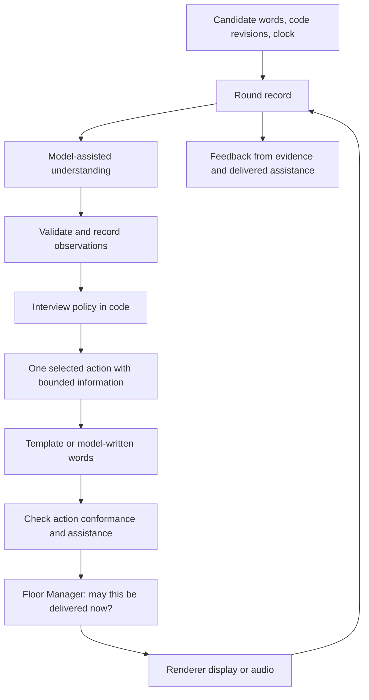

> Historical review: the owner subsequently clarified the target as candidate-led and observant, with neutral pokes when stuck. Earlier proposals for proactive leadership are superseded by the clarification at the top of spec.md.

# Proposal: a quiet, active interviewer

Status: proposal for owner review; no runtime changes or accepted ADRs changed

2026-10-30. Builds on the repository review and the owner's clarification: **the interviewer should manage time and ask useful questions while remaining quiet and leaving the candidate to do the thinking.** Other behavioral changes below are recommendations, not settled decisions.

## Recommendation

Give the interviewer responsibility for the conversation and the candidate responsibility for the solution. Preserve the Floor Manager. Add a small, explicit interview policy between understanding the candidate and writing the interviewer's words. Keep evidence of the candidate's work separate from both the conversational agenda and the interviewer's assistance.

The desired behavior is:

> Listen while the candidate makes progress. Ask a concise question when it will clarify their reasoning, gather missing evidence, resolve a misunderstanding, or manage the remaining time. Offer bounded help when they need it, and record exactly what the interviewer supplied. Leave the candidate room to choose, explain, test, and revise their solution.

“Human-like” is a target style, not a complete specification. Human interviews vary. This proposal defines one consistent baseline: calm, attentive, professionally warm, and active when there is a reason. It does not introduce company packs, personalities, or a coaching mode.

## 0. Handoff to an implementing agent

### Readiness and authority

This file carries the design rationale and conversation context needed to continue without the original chat. It is a design proposal, not yet a fully settled implementation contract. The owner explicitly selected **quiet but active: manages time and asks useful questions**. The owner has not yet separately approved every recommendation about hint consent, checking coverage, or grading changes.

Read this with the repository available. The code, tests, historical decisions, and uncommitted changes are part of the handoff. A copy of this markdown alone cannot establish the exact implementation baseline. At the time of review, ADR 0019 and many interviewer changes existed in the working tree without being committed; preserve and inspect that work before editing. Re-check the current state rather than assuming the line numbers or test count below remain current.

If the owner later explicitly directs implementation of this proposal, treat that direction as authorization for the behaviors it describes; do not repeatedly ask approval for those same choices. Distinguish routine implementation decisions from genuinely unspecified product decisions. Where a proposal changes accepted decisions, update the current behavior contract and the affected ADR amendment notes as part of the authorized change.

### Reading order and implementation map

1. `AGENTS.md`, then `docs/STATUS.md`, `GLOSSARY.md`, and `docs/agents/domain.md`.
2. This proposal, then ADRs 0014 and 0017–0019. Consult D5, D10, and D11 in `docs/DECISIONS.md`; ADR 0016 explains the provider boundary.
3. `packages/engine/src/interviewer.ts` and `prompt.ts`: current orchestration, mixed observation/reply schema, generation, checking, rejection, and bookkeeping.
4. `packages/engine/src/floor-manager.ts`, `phases.ts`, and `round.ts`: timing, barge-in, suggestions, and phase state.
5. `packages/engine/src/grading.ts` and `packages/core/src/index.ts`: evidence, caps, area scores, and the verdict table.
6. `packages/engine/src/problem.ts`, `content/problems/two-sum/interviewer.md`, and `content/interviewer/lines.md`: content parsing, private knowledge, hints, and tone/fallback conflicts.
7. `apps/desktop/src/main/active-round.ts`, `events-log.ts`, and `index.ts`; renderer `room/Room.tsx`, `useTranscript.ts`, and `useSubtitle.ts`: input snapshots, logging, delivery, and cancellation.
8. The corresponding engine tests, `packages/engine/src/test/fakes.ts`, and desktop E2E tests for interviewer, phases, and Feedback. `.scratch/interviewer-check/grilling.md` records the previous owner's decisions and planned live-model suite; this proposal explicitly reopens parts of that design.

### Four demonstrated regressions to preserve in tests

The earlier review used temporary scripted-model reproductions, then removed the temporary test. Add permanent regressions; do not assume those reproductions are already in the suite.

| Reproduction | Observed failure | Required behavior |
| --- | --- | --- |
| Second check-in names a code mistake; check returns `namesMistake: true`, `hintLevel: none`, `describesSolution: false` | Check verdict is lost because check-ins lack `observed`; the mistake is spoken and unrecorded | Unauthorized diagnosis is rejected on every speech path |
| Two drafts are rejected; walkthrough fallback asks for an example; candidate traces one | Candidate gets independent-testing credit because fallback did not record its question | Delivered fallback question is linked to the candidate's response |
| A candidate turn is interpreted as checking code, finding a mistake, and moving activity; both reply drafts are rejected | All those candidate observations disappear | Supported observations survive speech rejection, with source references and no duplication |
| Candidate requests debugging help while still working and receives a diagnosis, having never claimed completion | `doneWithMissedBug` becomes true | Completion-related penalties require an applicable completion claim and evidence about the same work |

### Remaining product decisions and engineering parameters

The quiet-but-active direction is settled. These recommended details need adoption or an explicit alternative before the full redesign can be treated as settled:

- **Assistance:** offer help before supplying a solution insight when stuck; permit useful focused probes while recording the information they supply; keep complete answers outside the assessed round. Define approved hint content concretely for Two sum.
- **Checking:** check all free-written problem-specific turns, allowing reviewed templates with bounded facts to bypass. This changes the earlier selective-check trade-off and must be evaluated for latency.
- **Feedback:** replace the blanket prompted-testing and deepest-hint treatment with evidence-sensitive anchors. The exact rubric and treatment of insufficient evidence still need calibration. Preserve the four areas and verdict table unless separately authorized to change them.

Data structures, module boundaries, debounce intervals, and latency budgets are engineering decisions to substantiate with tests and measurements. Do not freeze arbitrary numbers solely because a spec needs a number. This proposal intentionally does not prescribe every interface or an unmeasured latency target.

### Completion evidence

After implementation, another agent should be able to inspect the selected action, its reason, input/code references, actual delivered information, and resulting evidence for each worked example in sections 8–9. Show that templates, generated turns, check-ins, fallbacks, retries, and cancellations obey the same accounting rules. Demonstrate that existing evidence prevents redundant questions and that observation failure never becomes invented negative evidence.

Run the relevant deterministic regressions first, then the repository checks appropriate to the change: `pnpm test`, `pnpm typecheck`, `pnpm lint`, `pnpm build`, and `pnpm test:e2e` for desktop integration changes. Diagnose and report environmental blockers separately from implementation failures. The 101-test result in section 1 is a historical baseline, not validation of new code.

The real-model suite remains manually invoked and outside CI. Record the tested model/configuration, complete-round scenarios, repeated-trial results, latency, and an owner-reviewed sample of natural interactions. A passing fake-model suite establishes mechanics. Claiming excellent interaction quality requires actual rounds and iteration; identify any unperformed evaluation explicitly.

## 1. Why these conflicts developed

### 1.1 The behavioral target changed through local corrections

The original thesis and D5 split deciding whether to speak from writing the words. That is a strong foundation. The early implementation used keyword classification and timed phase offers. Real rounds exposed failures: casual speech was misunderstood and the interviewer tried to move on mid-thought. ADR 0017 replaced keywords with model understanding and prohibited clock-driven progression.

A later round exposed leaked bugs, premature transitions, prompted testing credited as independent testing, and premature closure. ADR 0018 added app-owned bookkeeping and more prohibitions. ADR 0019 added a separate check and amended memory, phase direction, and grading.

Each change addressed a real failure. However, the changes did not establish a single account of **which interventions are useful, which supply assistance, and which change the evidence used in grading**. The earlier examples and problem notes survived alongside the new restrictions. The result is a set of individually understandable rules that disagree as a whole.

The most consequential overcorrection is in `prompt.ts`: “testing, edge cases and complexity are theirs to bring up.” That makes the interviewer passive precisely where a structured interviewer might ask a useful assessment question. The owner's newly selected target reopens this part of ADR 0017.

### 1.2 Several different kinds of intervention are treated as one

These questions give very different amounts of information:

| Interviewer turn | What it supplies |
| --- | --- |
| “What cases would you choose to check this?” | An assessment topic; the candidate still chooses the cases and expected behavior |
| “How does this behave when values repeat?” | A particular boundary condition; some testing work has been supplied |
| “Walk through this duplicate-value input.” | A specific diagnostic case, possibly selected to expose a suspected bug |
| “The map overwrites the earlier index.” | The diagnosis |
| “Look up the complement before inserting the current value.” | A repair or algorithmic step |

The current `asks`, `pointsOutMistake`, and global hint rung do not represent these distinctions well. In particular, a question can provide substantial help without naming a technique or stating a fix. Conversely, asking about complexity need not supply any solution information.

Therefore “never hint unasked,” “probe reasoning,” “don't lead testing,” and “ask for a failing trace when done” collide. The missing abstraction is the **purpose and information supplied by an intervention**.

### 1.3 Bookkeeping moved into code, but authority largely remained in the generated reply

`TurnWords` in `packages/engine/src/interviewer.ts` contains candidate interpretation, a phase command, the reply action, words, and self-assessed assistance in one object. The model still chooses the intervention and substantially determines what the state means. Code stores and checks its claims.

This coupling explains why rejecting the words loses candidate observations, why rewriting the words can reinterpret the candidate, and why check-ins and fallbacks bypass bookkeeping designed around a normal turn. `Observed` even combines candidate observations with effects of interviewer speech.

An additional check improves detection, but its trigger still depends partly on the writer's classification and labels. A misclassified help-bearing reply can avoid it. A separate call to the same model also remains fallible; it is not an independent source of truth.

### 1.4 Phase is doing too many jobs

The single phase is simultaneously a display label, current conversational topic, sequencing rule, and proxy for progress. In a natural conversation, a candidate can explain complexity while describing an approach, test while coding, and return to a bug after answering a follow-up.

Moving to Test does not prove testing happened. Asking a testing question changes the conversational topic, but does not prove the candidate chose to test. Saying “done” may mean done explaining, done implementing, or ready to end the round. A single categorical phase cannot carry all of that information.

### 1.5 Counts replace causal evidence

`lastAsk` and `lastPointedOut` stand in for the relationship between a question, the answer, a particular bug, and the code version under discussion. `doneWithMissedBug` then infers a completion failure from any interviewer-associated mistake. These shortcuts explain both the fallback-attribution bug and the excessive grading penalty.

The problem is not just missing booleans. The app needs to know **which question elicited which evidence, and which completion claim applied to which code**.

### 1.6 Prompts and examples have become competing policy sources

Policy exists in AGENTS.md, historical decisions, later ADRs, prompt rules, phase instructions, tone examples, and problem notes. At runtime the writer receives the full reference solution, all hint rungs, and the entire tone file, including instructions and examples unrelated to the selected action.

Labeling these blocks “notes” or “tone” does not prevent the model from following their behavioral examples. More prompt text cannot resolve contradictory authority automatically. The separation must exist in content structure and prompt construction.

### 1.7 The tests establish mechanics, not interviewer judgment

The reviewed engine suite passed 101 tests, while scripted reproductions demonstrated four bugs. Many semantic tests supply the desired candidate classification and check verdict themselves. Those tests establish how code handles labels; they cannot establish whether a real model assigns the right labels or asks a useful question.

The already planned fake-candidate suite is essential. It needs tests for useful intervention as well as restraint: an interviewer that says nothing all round can score perfectly on “never gave a hint” while failing its job.

## 2. What to preserve and what to reopen

Preserve: the Floor Manager, deterministic replay, original plain-file problems, one baseline interviewer, candidate barge-in, evidence-based Feedback, renderer audio, provider independence, and network-free CI.

| Existing decision | Proposed treatment |
| --- | --- |
| D5: timing separated from language generation | Preserve and complete the separation by adding explicit interview policy |
| ADR 0014: one interviewer before personas | Preserve |
| ADR 0017: interviewer never pushes; candidate must initiate testing and complexity | Reopen: interviewer may manage the agenda and elicit reasoning at natural boundaries |
| ADR 0017: spontaneous small hints when stuck | Recommend offering help first; silence or uncertainty alone does not authorize a solution insight |
| ADR 0018: app owns state and assistance attribution | Preserve the intention; separate candidate evidence from delivered interviewer actions |
| ADR 0018/0019: phase follows candidate words only, except follow-ups | Revise: topic can follow either party; achievement and initiative require candidate evidence |
| ADR 0019: prompt-only move restrictions | Reopen: code enforces clear lifecycle, disclosure, and stale-state constraints; semantics stay model-assisted |
| ADR 0019: selective check | Reopen the trigger: check all free-written problem-specific turns; reviewed, bounded templates can bypass |
| ADR 0019: fixed testing caps | Fix the documented bug first; recalibrate caps for the new, more active policy before shipping it |
| ADR 0019: full conversation in every prompt | Preserve full history in storage. Initially retain it for understanding; do not require every model role to receive every hidden fact |

This document is not an ADR and does not supersede those decisions. The owner has selected the overall quiet-but-active direction; the specific changes still need review.

## 3. A behavioral contract for the baseline interviewer

### 3.1 Initiative

The interviewer may introduce the problem, answer factual clarifications, ask for an explanation, ask the candidate to select tests, ask about trade-offs or complexity, introduce relevant follow-ups, and manage the remaining time.

These actions need a reason tied to the conversation. They are not a checklist to announce or run after every turn. Use evidence already supplied, even if it arrived out of order. Do not ask for complexity again because the display later changes to Complexity.

Ask one substantive question at a time and wait for its answer. Prefer a question that distinguishes plausible interpretations of the candidate's reasoning over a generic request for more explanation. Stop probing once the needed evidence is available.

The candidate chooses the approach, writes the implementation, chooses examples when asked an open testing question, explains expected behavior, and makes revisions. The interviewer does not need a separate “yes” at every boundary. “Let's look at how you'd check this” is a normal transition after an implementation is finished. A candidate's request for another moment should be respected within the remaining round time.

### 3.2 Silence, questions, and help

| Situation | Default behavior | Boundary |
| --- | --- | --- |
| Candidate is reasoning or making progress in code | Listen; occasional backchannel if appropriate | Do not turn every completed sentence into a question |
| Candidate asks a factual problem question | Answer the relevant fact briefly | Do not attach an approach or unsolicited edge case |
| Reasoning is unclear or a claim lacks justification | Ask one focused explanatory question | Do not smuggle the missing reasoning into the question |
| Candidate finishes implementation without discussing checks | Ask how they would check it | Record that the interviewer elicited testing |
| Candidate has already tested effectively | Use that evidence and move on | Do not repeat the testing ritual |
| A bug is suspected | Invite a self-check, then a more focused check only if needed | Record any selected case or diagnostic information the interviewer supplies |
| Candidate requests bounded help | Supply one appropriate, approved insight | No complete implementation or full algorithm recipe |
| Candidate says they are stuck | Offer a choice: a little time or a small hint | Do not infer permission to reveal the next rung merely from frustration |
| Candidate is quietly working | Wait | No hint escalation just because another timer expired |
| Prolonged unexplained inactivity | Neutral check-in, then back off | No repeated escalating lesson |
| Time is becoming short | Brief time reminder or negotiate a concise next task at a natural boundary | Do not interrupt a live trace simply because a phase share elapsed |
| Candidate completes the available work early | Ask useful follow-ups if appropriate, then close naturally | Do not manufacture questions to consume 45 minutes |
| Candidate requests the answer | Explain that the full solution can be discussed after ending the round | Do not turn the assessed round into a walkthrough silently |

Warmth is allowed: greetings, “take your time,” and brief acknowledgements. Avoid repeated praise, premature correctness guarantees, and cold refusal boilerplate. “Sounds reasonable” should not be the default response to an approach the interviewer believes is wrong.

“Does this look right?” permits an assessment-oriented response, not unlimited debugging help. A request about a syntax error permits explaining that language issue, not introducing the optimal algorithm. Requests for help are scoped to the obstacle and should not become permanent permission for later turns.

Preserve the existing End round control. A time limit creates a time-management or closing action, not an automatic `round-end` event. The candidate can finish a thought and end the round; extending or enforcing a hard cutoff would be a separate product decision.

The interviewer is a mock interviewer, not a representative of a real employer. During wrap-up, it should not invent a company's team, role, hiring decision, or interview process.

### 3.3 Assistance is information, not sentence form

Use a few explicit categories, with the affected skill recorded separately:

| Category | Example | Evidence consequence |
| --- | --- | --- |
| Process management | “We have about ten minutes left.” | No algorithmic assistance |
| Open evidence question | “What cases would you choose?” | Testing topic elicited; case selection and reasoning remain the candidate's |
| Focused probe | “How does this behave with repeated values?” | Boundary condition supplied; judge the subsequent reasoning on its own merits |
| Diagnostic support | Interviewer selects a failing input or identifies a faulty invariant | More specific help supplied; independence for that discovery is limited |
| Solution insight | An approved algorithmic concept or partial repair | Record the particular concept supplied and what the candidate does afterward |
| Complete answer | Full implementation or sufficient recipe to reconstruct it | Out of bounds during the assessed round |

A focused probe may be useful and permitted without being free of assistance. “Allowed to ask” and “counts as independently demonstrated” are separate questions. It is also possible to ask a leading question using only concepts already present in the transcript; a list of new keywords is not a sufficient disclosure check.

## 4. Proposed architecture

The Floor Manager also observes candidate activity directly so it can stop speech immediately. The diagram describes logical dependencies, not a requirement for a new service, process, or model per box. Keep this inside the existing engine/provider separation.

### 4.1 Record input before generating speech

Every candidate turn and code revision gets an identity. Interpretation is attached to those inputs, not to whichever reply finally survives generation. An interpretation can be corrected by a later event without rewriting the original input.

Apply each accepted interpretation once, tied to its input and interpretation version. A barge-in can invalidate a proposed reply while leaving an observation about an earlier completed turn valid. If understanding fails, retain the raw input and an unresolved interpretation; a later pass can recover the evidence. Never convert a timeout into “the candidate did not test.”

The understanding output describes candidate acts and evidence. It does not grant the interviewer permission to reveal information. Allow multiple acts in one turn and an explicit unknown: “I've finished implementing, can you check it?” includes a completion claim and a request, whose scope may need clarification.

Require source turn IDs, relevant code revision, and short supporting excerpts or code spans. Validate that references exist. This establishes provenance, not semantic correctness. Model interpretations remain fallible and should be logged as interpretations; uncertain bug detection must not become an established fact for grading.

The observer may also report a suspected correctness issue and suggest a probe. Code chooses whether that probe is appropriate and whether its information is within the permitted assistance. No fixed list of stock questions will cover every useful interview question.

### 4.2 Separate three pieces of round state

| State | What it answers | What it must not imply |
| --- | --- | --- |
| Lifecycle | Is the round active, closing, or closed? | A candidate finishing implementation did not end the round |
| Conversation | What is being discussed; what question is pending? | Asking about testing did not establish testing skill |
| Evidence | What did the candidate demonstrate, with what support? | A phase label is not an achievement |

Keep the existing phase labels as a view of the current activity initially. Coverage of skills lives in the evidence record and can span phases. The interviewer may ask about complexity during Approach; that evidence still counts later. Preserve the ability to return to code.

Questions have IDs, a purpose, a target, and a state such as pending, answered, declined, or superseded. A follow-up can refer to an unanswered part of an earlier question. Replace the absolute “never ask a question you've already asked” with “do not repeat an answered question without a new reason.”

Completion claims include scope and a code revision. Bug records refer to the affected code and distinguish suspected, supported by evidence, and resolved. They identify who supplied the failing case, who diagnosed the problem, and who repaired it. A request for debugging help before a completion claim is not a completed submission with an uncaught bug.

### 4.3 Select an action before asking for its words

Start with a small action vocabulary: listen, acknowledge, answer clarification, ask explanation, ask candidate to choose checks, ask a focused probe, offer help, give approved hint, manage time, introduce follow-up, and close. Represent these as a discriminated union so fields appropriate to a hint cannot silently disappear for a check-in.

An action carries its reason, question or hint identity where relevant, source turn, code revision if relevant, and the information it is allowed to supply. It also carries effects to apply only if delivered.

For example, an open testing question could refer to candidate turn `t18` and code revision `c7`, use the reviewed question “What cases would you choose to check this?”, and open question `q4` on delivery. Its permitted information is the testing topic alone. The next candidate turn can reference `q4` while earning evidence for their own case selection. If the interviewer instead selects a duplicate-value input, that is a different action with additional recorded diagnostic support. Neither action writes a `candidate-tested` fact by itself.

The policy applies a small set of priorities:

1. Respect end-of-round, barge-in, and explicit candidate requests.
2. Answer a direct question or repair a misunderstanding before introducing a new topic.
3. Resolve the current question before asking an unrelated one.
4. Let productive work continue.
5. At a natural boundary, gather the most useful missing evidence within the remaining time.
6. Offer help when there is evidence of a stall; give help within the accepted scope.
7. Use relevant follow-ups or close when the available work is complete.

This is a policy over semantic observations, not a return to keyword matching. Code enforces what it can know exactly: pending question identities, approved hint scope, lifecycle, whether a time reminder already happened, and whether the state used to plan a turn is stale. The model still handles meaning, explanation, and candidate-specific probing.

### 4.4 Give the writer only the context needed for the action

Split problem material into public facts, assessment notes, possible approaches and pitfalls, approved help, and follow-ups. The current markdown file can remain plain files with parsed sections; a new content service is unnecessary.

The observer and checker can receive the relevant private assessment material. The speaker receives the public problem, relevant conversation and candidate work, one selected action, and only the private facts authorized for that action. It does not need the full canonical solution to acknowledge, ask for complexity, or answer whether values can repeat.

A hint action supplies exactly its approved content and bounds. Rewrite the current concrete Two sum rung: it gives almost the entire algorithm in one sentence. An interview hint may introduce a substantive concept, but the final rung must still leave meaningful work for the candidate. If a complete recipe is the next useful teaching move, save it for after the assessed round.

Information reduction limits accidental disclosure; it does not guarantee withholding. A pretrained model may already know Two sum, and candidate code itself may contain the solution. The checker must judge what the turn adds in context.

### 4.5 Check the selected action, not just “is this a solution?”

The check receives the selected action, allowed facts or hint, candidate evidence, draft words, and relevant assessment notes. It determines whether the words perform the intended action, whether they add unauthorized diagnosis or solution information, and whether they add another question or inappropriate evaluation.

For an approved hint, restating its permitted concept is expected. Going beyond it is a rejection. For a complexity question, attaching the correct complexity before the candidate answers is a rejection. For a focused bug probe, supplied diagnostic information must match the action's recorded assistance.

Check every free-written turn about the problem or candidate work, including factual answers. Reviewed templates can bypass the semantic call only when their slots are bounded, validated facts or approved content; an arbitrary model-written slot is still free writing. This closes the self-classification loophole while letting routine questions stay fast. The writer's own labels never determine whether it needs checking. Treat malformed or uncertain checks as unable to authorize the draft.

Use the same validation and delivery path for model-written text, check-ins, templates, and fallbacks. After one failed rewrite, fall back to a reviewed version of the **same action** where possible. A failed factual answer should not become a request to trace the candidate's code. If no safe factual answer is available, briefly acknowledge the technical problem rather than inventing one.

### 4.6 Commit interviewer effects when the candidate receives them

Planning or generating a hint does not mean it was supplied. Candidate observations survive failed speech; interviewer assistance and pending questions are recorded only when their words are delivered.

For today's text UI, delivery means the renderer displayed the full turn; it is not “read at 15 characters per second.” For future voice, record start, completion, interruption, and available delivered text or segments. Do not assume a full hint was heard if speech was cancelled before its substantive content. Use a conservative unknown when delivery cannot be established.

Plans refer to a round revision and relevant code revision. Before delivery, revalidate their assumptions. New candidate words can cancel a pending question; code edits can invalidate a bug probe. Do not cancel a general time reminder merely because unrelated editor text changed. Revalidation should be specific to the action.

Editor activity currently carries no new code. Add revisioned snapshots at useful boundaries and debounce updates during editing. Refresh the snapshot before code-specific comments. Keystrokes are evidence of activity, not proof of conceptual progress.

## 5. Latency and implementation size

Separate responsibilities do not require a fleet of agents. Use the existing `Model` interface and implement observation and speech as distinct request purposes. Make policy and state projection pure TypeScript.

For a first implementation:

| Action path | Calls normally needed |
| --- | --- |
| Clock-only reminder or fixed opening | No model call when a reviewed template suffices |
| Understand candidate, then listen/acknowledge/ask a routine open question | One understanding call, then silence or a reviewed template |
| Contextual factual answer or explanation probe | Understanding, writing, and check; a reviewed template with validated fact slots can eliminate the last two |
| Hint or targeted diagnostic probe | Understanding, writing, and check; approved verbatim hint text can eliminate writing |

Allow the observer to propose a probe target so the writer does not need to solve the candidate's code again. Keep the real Floor Manager responsive during all calls; understanding alone should not claim the floor or show “preparing to speak” for a turn that will remain silent.

ADR 0019 currently permits up to two reply calls and two checks, each with a ten-second timeout: roughly forty seconds on a repeatedly failing path, before speech. Add a bounded end-to-end foreground budget with a fallback, not just per-call timeouts. Choose the actual budget from measurements on supported hardware and providers; do not promise human-speed turnaround on an unmeasured CPU-only model.

Measure latency by path, total wait, retries, and candidate interruption rate. Optimize stable prompts and routine templates first. If latency forces a different architecture later, compare it against this separated baseline with the same scenarios. A speculative combined observation/draft call is an optimization to evaluate, not the semantic source of authority.

## 6. Feedback must distinguish initiative from competence

Record who initiated a topic and what the interviewer supplied, then assess what the candidate actually did. A candidate who chooses excellent cases after “how would you test this?” demonstrated testing competence, while providing less evidence of independent initiative than someone who began testing unprompted.

Likewise, a candidate who diagnoses and repairs a bug after an open self-check question has demonstrated more independence than someone who fixes the exact line named by the interviewer. A single `by: interviewer` label loses this distinction.

Preserve the four existing areas and verdict table initially. Recommend replacing global caps based solely on deepest hint or any prompted testing with anchored judgments about the affected evidence. This requires calibration and owner approval; the external sources below do not establish a universal numerical penalty.

For example, testing anchors could distinguish: no meaningful verification despite an opportunity; limited coverage or heavy diagnostic support; sensible normal and boundary cases with sound expected results; and systematic checks with clear reasoning and little support. Initiative remains part of the evidence, not the sole definition of testing quality.

Unsolicited help caused by an interviewer failure must not be described as “hints the candidate asked for” or automatically charged as a candidate weakness. Mark the affected independent evidence as unavailable and explain the limitation when material. An unobserved skill is not necessarily a demonstrated failure, especially if time or system failure prevented a fair opportunity.

Do not call a suspected LLM-found bug confirmed without supporting code reasoning or execution evidence. There is no runner in v0.1. Compare alternative valid approaches on the problem contract, not textual resemblance to the Python reference. Retain uncertainty rather than manufacturing a precise score from weak evidence.

## 7. A coherent source of instructions

Create one current behavior contract in `docs/interviewer-behavior.md` after approval. ADRs explain why and record amendments. AGENTS.md links to the current contract and gives coding-agent rules; it should not duplicate a frozen summary of every behavioral exception.

The approved policy implementation and versioned prompt blocks operationalize that contract. Problem files supply facts, assessment targets, and approved help; they do not override general timing or assistance rules. Examples are selected for the action being performed and demonstrate tone without introducing a second behavioral policy.

For a behavior change, update the contract, any superseded decision note, affected prompt/content blocks, and a representative scenario together. Name policy tests after contract behaviors. A documentation link alone does not keep these representations consistent; scenario regressions are the practical cross-check.

Avoid keeping the whole current `lines.md` as every writer's tone guide. Separate reviewed fallback turns from a small set of action-specific wording examples. Remove obsolete timing and progression instructions from example prose. Make the structured-output request and its prompt agree rather than ending a structured observation request with “only the words you say aloud.”

Record policy version, prompt version or hash, content version, model identity, input event and code references, selected action and reason, check result, delivery outcome, and assistance supplied. Keep credentials out. Save enough versioned local context to replay decisions without contacting a model; a log of final labels alone cannot reproduce semantic decisions reliably.

The proposal introduces more precise concepts such as completion claim, question status, code revision, and delivered assistance. Define these in the glossary when adopted, rather than silently stretching the existing meanings of Phase, Candidate turn, or Hint. Set an explicit precedence: the current behavior contract incorporates accepted ADR amendments; historical ADR text and problem examples cannot silently override it.

This requires a few typed events and projections, not a general event-sourcing framework. The core state and policy can remain pure; providers perform model I/O; Electron owns file and renderer boundaries on all three operating systems.

## 8. Worked examples

### Correct implementation, no tests yet

Candidate: “That's the implementation.”

Interviewer: “How would you check that it behaves as intended?”

Candidate chooses inputs, predicts outputs, traces them, and discusses boundaries. Record the implementation completion claim, interviewer-elicited testing topic, candidate-chosen cases, and quality of reasoning. Do not give full initiative credit, do not automatically cap competent testing at mixed, and do not suggest an edge case before the candidate has a chance to choose.

### Candidate fixes a bug during their own trace

Candidate: “With [5, 1, 5] I return the wrong positions. I need to keep the earlier index.”

Interviewer listens or acknowledges briefly. Record a self-initiated check and candidate diagnosis on the relevant code revision. Revising code changes current activity; it does not erase testing evidence or start a new mandatory interview sequence.

### Interviewer notices a possible bug after completion

Interviewer first asks the candidate how they would check their work. If the candidate's cases miss the suspected issue, a focused probe can be useful: “What about repeated values?” Record that supplied focus. If a concrete failing input is later supplied, record that additional diagnostic support too. The candidate can still earn credit for correctly tracing, identifying the cause, and repairing it.

There is no need to pretend a selected counterexample is information-free merely because the interviewer did not say “bug.”

### Candidate is stuck

Candidate: “I can't see another approach.”

Interviewer: “Would you like a small hint, or a little more time?”

If they accept, select one bounded hint relevant to their current obstacle. Record the request, content, and delivery separately. Do not advance through the global algorithm ladder if the actual obstacle is a language detail or a different approach.

### Time is short while the candidate is progressing

At the next natural pause: “We have about five minutes left. How would you check your solution?” Discuss trade-offs afterward if time remains and they have not already been covered.

The pending agenda changes; completed evidence does not. If the candidate asks to finish the current trace, allow that within the round boundary. Do not repeat the reminder every tick or inject a new algorithm to accelerate them.

## 9. Validation before calling this reliable

Keep three separate evaluation layers:

1. Deterministic CI with fake models/audio: input retention, event causality, action rules, cancellation, template/fallback parity, grading attribution, and replay. No network.
2. A manually invoked real-model regression suite: fixed candidate turns plus open-ended simulated candidates, repeated trials, saved transcripts and events. This follows the existing no-network-in-CI decision.
3. Human review of selected rounds and disputed judgments: natural timing, relevance of probes, leading questions, valid alternative solutions, and fairness of Feedback. An LLM judge can assist triage but cannot establish its own correctness.

| Scenario | What must be checked |
| --- | --- |
| Correct code, no tests yet | One useful open testing question; attribution preserved |
| Tests and complexity supplied before coding ends | Evidence reused; no repeated checklist questions |
| Wrong but plausible approach | Focused reasoning probe without supplying the approach |
| Correct brute force | Understand the trade-off; optimization discussion need not reject valid code |
| Candidate discovers and repairs their own bug | Independent discovery retained through code revisions |
| Candidate fixes after an open question versus a named defect | Assistance distinctions affect the evidence correctly |
| Help requested before completion | No false “done with missed bug” fact |
| Hint requested; answer fishing; prompt injection in code | Bounded authorized content; no complete recipe |
| Long silence, active coding, explicit request to think | Check-in policy respects context; no automatic hint escalation |
| Candidate rambles or repeats | Relevant redirection at a boundary; no reward for verbosity alone |
| Multiple acts, typos, fragmented turns, later ASR errors | Meaning preserved, uncertainty handled, no duplicate evidence |
| Writer/check fails; fallback; barge-in; code edit during generation | Observations survive; stale or undelivered actions do not affect assistance records |
| Finishes early; runs out of time; asks to stop | Natural and consistent lifecycle handling |
| Same algorithm in Python, JavaScript, Java, C++, or Go | No Python-reference matching bias |
| Model/context/quantization change | Rerun the suite for that actual configuration |

Measure useful questions as well as violations: relevance, redundant questions, unnecessary interruptions, opportunities gathered, factual accuracy, assistance classification, attribution accuracy, and response latency. Track complete-round reliability over repeated runs; a good single turn or an average score hides occasional damaging failures.

Proposed release rule: no critical disclosure or evidence-corruption failures in the agreed adversarial regression set, plus an owner-reviewed sample of natural rounds. Record the sample size and configurations. Passing samples is evidence of reliability, not a mathematical guarantee that any 8B model can never leak.

## 10. Implementation sequence

1. **Repair the four demonstrated bugs under existing decisions.** Add regression tests for check-in mistake verdicts, fallback attribution, observation retention through rejection, and completion-linked grading. These fixes do not require adopting the new interview style.
2. **Review this contract and write the amendments.** Settle assistance boundaries, routine probing, time management, and scoring. Update the current behavior summary and root links together.
3. **Build the record and pure policy with fake scenarios.** Introduce question IDs, revisioned code, completion scope, and independent evidence/delivery effects. Keep the existing phase display initially.
4. **Split understanding from wording.** Start with one understanding call and templates for routine actions. Add bounded wording and action-aware checks for substantive turns. Route every fallback through the same action delivery path.
5. **Run real rounds and the regression suite.** Compare the current and proposed designs on the same scenarios, inspect disagreements, and calibrate Feedback. Measure latency before committing to stronger local-model quality claims.
6. **Extend to voice.** Add actual audio delivery and interruption events while retaining renderer playback and the same policy/evidence model.

No new framework, vector database, multi-agent service, or new UI mode is necessary for this first design. The interesting handcrafted work is the policy, Floor Manager, event relationships, and behavior evaluation.

## 11. Evidence and limits of the recommendation

These sources support design principles; they do not prove the exact InterviewHarness policy or scoring thresholds.

- [Microsoft technical interviewing](https://careers.microsoft.com/v2/global/en/hiring-tips/technical-interviewing): emphasizes problem-solving process, testing, and explanation of complexity. [Microsoft's interviewer guidance](https://news.microsoft.com/life/how-to-ace-a-technical-interview-at-microsoft/) describes a conversation with guidance while also valuing unprompted checking. These support distinguishing demonstrated ability from initiative.
- [Google re:Work on structured interviewing](https://rework.withgoogle.com/intl/en/guides/a-guide-to-structured-interviewing-for-better-hiring-practices): planned questions and follow-ups, recorded evidence, and shared rubrics. The inference here is that active evidence gathering can coexist with consistent assessment.
- [StratL](https://arxiv.org/html/2410.03781v2): separates student-state tracing, deterministic intervention selection, and conditioned wording. Its small math-tutoring study also reports interpretation errors that can produce contradictory interventions. This supports the architectural separation and the need to test understanding; it is not an interview validation study.
- [AI Assistants Overassist / Int-Bench](https://arxiv.org/abs/2607.21306): observes earlier and more frequent intervention and excessive solution disclosure relative to humans in learning tasks. It supports deliberate restraint, but does not establish a blanket rule that interviewers should never initiate testing or complexity.
- [Rasa dialogue understanding](https://learning.rasa.com/rasa-pro/dialogue-understanding/): illustrates contextual language understanding producing structured commands for controlled conversation flow. It is an architectural comparison, not a recommendation to adopt Rasa.
- [τ-bench](https://arxiv.org/abs/2406.12045): motivates testing policy adherence and consistency across complete repeated interactions. Its domains are not coding interviews; borrow the evaluation principle, not its model scores as predictions for this app.
